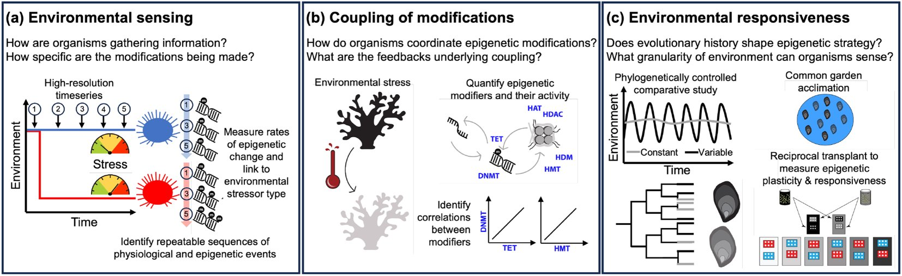

Can an oyster or a coral "remember" the conditions it has lived through? Our field has spent more than a decade generating DNA methylation, histone, and noncoding RNA datasets from marine invertebrates exposed to warming, acidification, disease, and other stressors. The data keep piling up, but a basic question has been surprisingly hard to answer: **what would a cell actually need to do for epigenetic marks to track a changing environment?**

Our new Perspectives paper in *Environmental Epigenetics* takes that question head on.

> Moeller HV, Putnam HM, Cunning R, Roberts SB, Eirin-Lopez JM, Nisbet RM (2026). Epigenetic intelligence: how organisms track their environment through molecular memory. *Environmental Epigenetics* **12**(1), dvag032. <https://doi.org/10.1093/eep/dvag032>

{fig-alt="Diagram showing an environmental cue producing cofactors that lead to net removal or net addition of epigenetic markers on DNA and histones, altering gene expression and splicing variants."}

## From correlations to mechanism

Most environmental epigenetics studies (including plenty of ours) are correlational: expose animals to a treatment, profile marks, and look for differences that line up with the environment or with gene expression. That approach has been productive, but it leaves the mechanism as a black box.

Led by Holly Moeller and Roger Nisbet at UC Santa Barbara, this work flips the order. We built an **individual-based stochastic simulation** in which each organism carries a string of genomic "sites" that are either marked or unmarked, and the environment has its own string describing the best-matched epigenetic state. An organism's **stress** is simply the fraction of sites that are mismatched with the environment. The more stressed an organism is, the faster it remodels: marks are added and removed site by site, partly at random and partly "preferentially" at sites the organism can tell are wrong. The model is deliberately agnostic about whether a site is a single CpG, a gene, or a cluster of co-regulated marks, and about whether a mark activates or represses expression.

That framework let us ask three questions, each paired with a look at the empirical evidence in marine invertebrates and a clear statement of what is still unknown.

## 1. Tracking the environment requires site-level information

Without any information about *which* sites are mismatched, organisms never do better than chance: stress hovers around 0.5, the expectation for a random epigenome. Give them that information, and populations drop to roughly 15% mismatch within about 100 time steps, spike when the environment shifts, and then recover. The more an organism can separate preferential from random mark removal, the better it does.

{fig-alt="Time series of organism stress and proportion of marked sites with and without environmental information, plus a plot of stress decreasing as the environmental information parameter epsilon increases from 0 to 1."}

This lines up with patterns we and others have seen. Pteropods (*Limacina antarctica*) lose DNA methylation after acute low pH exposure and return to baseline within 6 days. Heat-stressed *Acropora cervicornis* methylation profiles diverge and then become indistinguishable from controls 8 days after the stress ends. Oysters, geoduck, and corals all show methylation shifts with acidification. What we still lack is the mechanism: how does an animal translate an environmental cue into a targeted change at the right sites?

## 2. Adding and removing marks must be coupled

If mark addition and removal get out of balance, an organism either strips its genome bare or marks everything, and either way ends up badly mismatched. Using a simple evolutionary algorithm (the most stressed individual dies, the least stressed reproduces, removal tendencies occasionally mutate), we found that higher addition tendencies always require proportionally higher removal tendencies. The exact balance depends on the environment: settings that call for few marks favor stronger removal.

Biochemically, addition and removal are handled by different enzymes (DNMTs versus TETs for DNA methylation; HATs, HDACs, and histone demethylases for histone marks), and both cost energy. How organisms coordinate these pools is an open question, and one we think ties epigenetics directly to an animal's energetic state.

## 3. Epigenetic tracking only works in some environments

We then let the environment shift in predictable ways, varying both how often it changes and how much. Organisms with good environmental information can follow infrequent changes, even big ones ("abrupt jumps"), and frequent changes if they are small ("slow and steady"). Frequent, large changes push stress back toward random.

{fig-alt="Heatmaps of mean stress, stress standard deviation, and stress range versus environmental change frequency and magnitude, plus raster plots showing a high-information organism closely following the environment and a low-information organism failing to."}

This leads to a prediction we are excited to test: lineages from highly variable habitats (intertidal zones, estuaries) should lean more heavily on epigenetic regulation than close relatives from stable ones. Oysters are a natural system for this, with Eastern and Pacific oysters living in fluctuating estuaries while relatives such as *Crassostrea nippona* occupy more stable coastal waters. We also argue that the environmental changes most likely to select for epigenetic responses are reversible ones that recur on the order of a generation or two.

## Where the field goes next

The paper closes with a call for experiments designed around mechanism rather than endpoints:

- **High-resolution time series** after a defined stressor, measuring physiology, gene expression, and epigenetic state together, repeated across lineages and species.
- **Quantifying the epigenetic machinery** (DNMT, TET, HAT, HDAC, and HDM abundance and activity) to see how addition and removal are coupled.
- **Phylogenetically controlled comparisons** of lineages from stable versus variable environments, using common garden and reciprocal transplant designs.

{fig-alt="Three-panel schematic of proposed experiments: high-resolution time series after a stressor, quantification of epigenetic enzymes such as DNMT, TET, HAT, HDAC and HDM, and comparative common garden and reciprocal transplant studies."}

For our lab, this is a roadmap. It pushes us toward designs that manipulate the timing and predictability of environmental change, measure mark removal as carefully as mark addition, and follow individuals through time rather than relying on single snapshots.

## A collaborative effort

This paper came out of the NSF *Understanding the Rules of Life: Epigenetics* program, bringing together modelers and empiricists: Holly Moeller and Roger Nisbet (UC Santa Barbara), Hollie Putnam (University of Rhode Island), Ross Cunning (Shedd Aquarium), Jose Eirin-Lopez (Florida International University), and our group at the UW School of Aquatic and Fishery Sciences. Bringing explicit mathematical frameworks together with empirical data is, we argue, exactly what the field needs to move forward.

## Learn more

- Full paper (open access): <https://doi.org/10.1093/eep/dvag032>
- Model code: <https://doi.org/10.5281/zenodo.23108257>
- Summary video and more: [Genefish post](https://genefish.wordpress.com/2026/01/26/epigenetic-intelligence-how-organisms-track-their-environment-through-molecular-memory/)
- Preprint: <https://doi.org/10.64898/2026.01.08.698487>

*Figures reproduced from Moeller et al. (2026) under a [CC BY-NC 4.0](https://creativecommons.org/licenses/by-nc/4.0/) license.*
