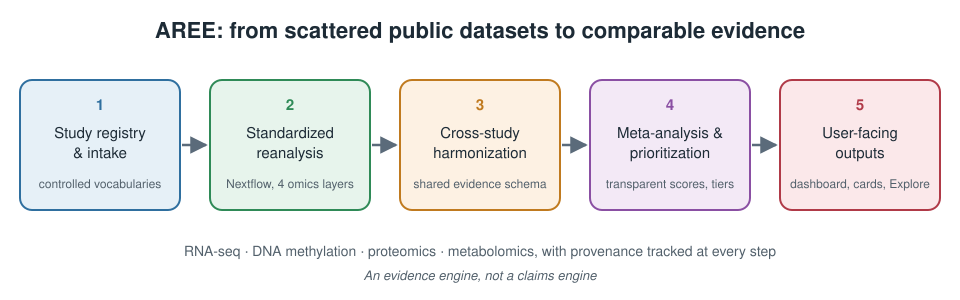

Which genes actually track with an oyster's ability to survive a heatwave, a disease outbreak, or acidifying water? The answer is probably already out there, scattered across dozens of published studies. The trouble is that those studies use different sequencing platforms, genome versions, phenotype definitions, and gene identifiers. Asking a simple question like *"which candidate genes show up consistently across independent thermal tolerance studies?"* means redoing the comparison from scratch every time.

That is the problem behind **AREE, the Aquaculture Resilience Evidence Engine**: an open, reproducible resource that converts fragmented public omics datasets into harmonized, comparable resilience-biomarker evidence for Pacific oyster (*Crassostrea gigas*), built to extend to other shellfish.

**Explore the progress and findings dashboard: <https://sr320.github.io/AREE/>**

{fig-alt="Diagram of the five AREE layers in sequence: study registry and intake, standardized reanalysis, cross-study harmonization, meta-analysis and prioritization, and user-facing outputs, spanning RNA-seq, DNA methylation, proteomics and metabolomics."}

## How it works

AREE is a working pipeline, not a literature summary. It has five connected layers:

1. **Study registry and intake.** Each public dataset gets a machine-readable registration using controlled vocabularies for phenotypes, stressors, tissues, and life stages, so "heat stress" means the same thing across studies.
2. **Standardized reanalysis.** Nextflow workflows reprocess RNA-seq, DNA methylation, proteomics, and metabolomics data, either from raw reads or from authors' published results tables.
3. **Cross-study harmonization.** Everything lands in one shared evidence schema, with gene identifiers mapped to a common reference and every mapping labeled with an explicit confidence level.
4. **Meta-analysis and prioritization.** Random-effects meta-analysis pools results across studies, with heterogeneity statistics and a transparent candidate score broken into named components (number of supporting studies, direction agreement, effect size, and more). Hard gates mean no candidate reaches the top tier without independent replication.
5. **User-facing outputs.** A live dashboard, an in-browser Explore page for querying the evidence tables, per-gene evidence cards, and tools that let AI assistants such as Claude query the evidence directly.

## An evidence engine, not a claims engine

The design principle we care most about is honesty. AREE identifies **associations and convergence** across studies and molecular layers. It never presents a significant hit in a single study as a validated biomarker. A few ways that shows up:

- **Resilience is kept separate from stress response.** A gene that responds to heat tells you an animal is stressed. A gene that already differs between resilient and susceptible animals *before* any stress is what a breeder can actually use. AREE labels every candidate by what kind of evidence supports it and keeps these classes apart.
- **Disagreement is surfaced, not averaged away.** When studies point in opposite directions, that conflict appears on the evidence card.
- **Provenance is tracked everywhere.** Every result traces back to its source file, checksum, parameters, and workflow version, and published supplementary tables are converted by committed, re-runnable scripts rather than copy and paste.
- **Simulated data stays quarantined.** Demo datasets used to test the pipeline are clearly labeled and excluded from real findings.
- **It says what it doesn't know.** Missing metadata, uncertain identifier mappings, and low replication are recorded and reported. The project even keeps a candid implementation status page that lists what is finished, what is only scaffolded, and what it previously got wrong.

## Where things stand

As of a mid-October 2026 snapshot, AREE had registered **30 real public studies** with 69 experimental comparisons, and harmonized more than **one million evidence records** from 16 of those studies across RNA-seq, methylation, and proteomics. That includes our first full raw reanalysis, an OsHV-1 challenge study, in which per-sample viral read QC caught an infected control animal that is now excluded from the analysis. Cross-study pools already exist for oyster disease susceptibility (up to five studies), oyster thermal tolerance, and Manila clam thermal tolerance, with work underway to bring in more mussel and clam species. The dashboard is regenerated from the pipeline's own outputs on every update, so check it for current numbers.

## Why it matters

For breeding programs and hatcheries, a candidate marker that will inform selection decisions needs a paper trail that a skeptical geneticist can follow back to source data. For researchers, AREE means the next public dataset can be added with a registration file and a handful of commands, rather than another one-off reanalysis. And for the field, it turns years of publicly funded sequencing into a shared, growing resource.

## Get involved

AREE is open source, and we welcome new datasets, species, and contributors.

- Dashboard and documentation: <https://sr320.github.io/AREE/>
- Code: <https://github.com/sr320/AREE>
- Have a public shellfish omics dataset that should be included? The documentation includes a step-by-step guide to adding a study, or just get in touch.
