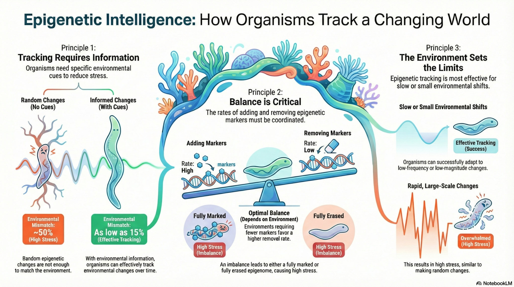

## Citation

> Moeller, H. V., Putnam, H. M., Cunning, R., Roberts, S. B., Eirin-Lopez, J. M., & Nisbet, R. M. (2026). Epigenetic intelligence: how organisms track their environment through molecular memory. *Environmental Epigenetics* **12**(1), dvag032. https://doi.org/10.1093/eep/dvag032

## Abstract

The regulation of gene expression by epigenetic markers is a growing area of focus for researchers who seek to explain rapid phenotypic acclimatization to environmental change. Yet even as empirical datasets accumulate exponentially, the mechanistic underpinnings of epigenetic changes and their role in connecting environmental variation with the regulation of gene function remain unclear. Here, we use a stochastic model of epigenetic change to generate three testable predictions: (1) that organisms require environmental feedback to track their environments through epigenetic responses, (2) that this tracking requires coordination between the addition and removal of epigenetic markers, and (3) that epigenetically driven tracking is only effective under specific subsets of environmental variability. Despite the intuitiveness of these postulates, few to no experimental studies directly test them. Using marine invertebrates as a case study, we review correlational evidence consistent with the model’s predictions, describe hypothetical mechanisms by which epigenetic strategies could evolve, and clearly identify knowledge gaps and urgent experimental needs in the field. Overall, the field of environmental epigenetics is poised for major advances, which can be enhanced through the continued synthesis of mathematical frameworks and empirical data.

Check out a Summary Video and more on [this post](https://genefish.wordpress.com/2026/01/26/epigenetic-intelligence-how-organisms-track-their-environment-through-molecular-memory/).
